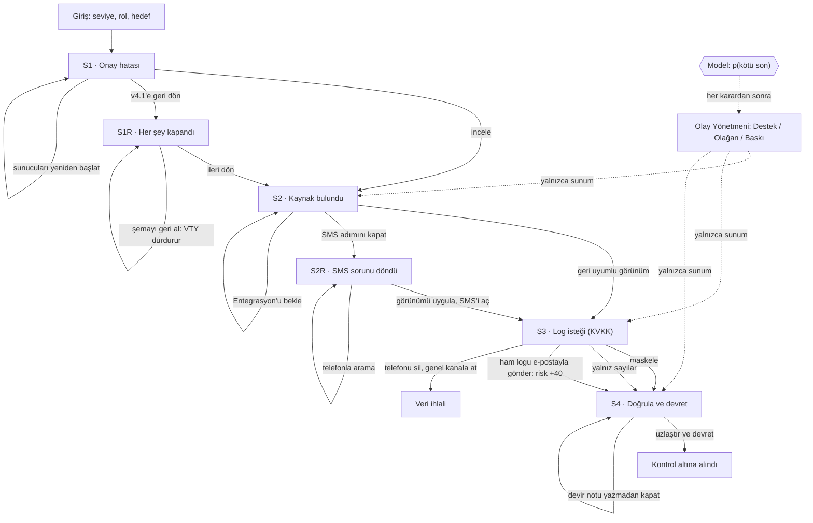

# SE Primer — Spec

**Sürüm:** 2.0 · **Teslim:** 6 Kasım 2026, 23:59 (v1.0: 30 Ekim 2026)
**Bağlı dosyalar:** `scenarios/sabah-randevu.json` (olay verisi), `content/glossary.json` (terimler), `content/eval_inputs.json` (tutor eval girdileri), `DESIGN.md` (görünüm), `data/SOZLUK.md` (veri sözlüğü), `train.py` (eğitim), `model/` (artefakt), `RELEASE.md` (yayın)

Bu belge uygulamanın sözleşmesidir. Kurallar ve sayılar burada ve olay dosyasında tanımlıdır; uygulama bunların dışında kural, sahne veya sayı icat etmez. v2'de eklenen ve değişen yerler **(v2)** ile işaretlidir.

> **Eşiğin yazıldığı an.** §13.4'teki kabul eşiği 31 Ekim 2026'da, veri toplanmadan ve model eğitilmeden önce yazıldı. Bu satırın tarihi git geçmişinde `data/oturumlar.csv`'nin ilk commit'inden öncedir. Eşik sonradan modele göre değiştirilmez; değişirse yeni sürüm numarası ve gerekçesiyle değişir.

---

## 1. Problem

Yazılım mühendisliği öğrencileri ve yeni başlayan mühendisler hataları genellikle sakin bir ortamda, tek başına ve doğru cevabı bilinen alıştırmalarla öğrenir. Gerçek bir olayda ise bilgi eksiktir, zaman daralır, başka ekipler ve yöneticiler baskı yapar, yanlış bir müdahale sorunu büyütebilir ve kişisel veri gibi geri alınamaz riskler vardır. Bu durumda doğru teknik bilgiyi doğru sırayla ve kendi yetkisi içinde kullanmayı güvenli bir ortamda deneyebilecekleri bir araç yoktur.

**Hedef kullanıcı:** Yazılım mühendisliği öğrencileri, stajyerler ve ilk yıllarındaki mühendisler; ayrıca sektöre dışarıdan bakan ama süreci merak eden kişiler (terim yardımıyla).

**Ürün vaadi:** Oyuncu gerçekçi bir yazılım krizine seçtiği rolle girer, kanıtı kendisi arayıp bulur, karar verir, kararının teknik ve insani sonucunu görür, hatasından toparlanabilir ve sonunda her kararının o an bildikleriyle değerlendirildiği suçlamasız bir rapor alır.

**(v2) Oyun oyuncuyu tanır.** v1'de uyum girişteki üç cevaba bağlı sabit kurallardı. v2'de oyuncunun oynarken bıraktığı izden (karar süresi, log aramaları, terim ve tutor kullanımı, önceki kararlar) küçük bir model, oyuncunun **kötü bir sona gidip gitmediğini** tahmin eder; **Olay Yönetmeni** bir sonraki sahneyi bu tahmine göre kurar (§13).

**Benzerlerinden farkı:** Teknik olay simülatörleri (youbrokeprod, The Incident Challenge, DevOps Dash, SadServers) oyuncunun ne yaptığını ölçer; SE Primer neden öyle yaptığını gösterir. Aynı olayı farklı rollerle oynatır, sonucu kurallarla belirler, not yerine suçlamasız değerlendirme verir; v2'de kanıtı oyuncuya hazır vermek yerine logda aratır ve oyunu oyuncunun davranışından öğrenen bir modelle uyarlar.

## 2. Kapsam

### Bu sürümde

- Telefonda açılan web uygulaması (Google AI Studio), hesap ve giriş yok.
- Girişte üç soru: seviye, rol, hedef; etkileri oyunda görünür.
- Bir tam olay: **Sabah Randevu Krizi** (sağlık sektörü). İki rol: **Backend geliştirici** ve **Takım lideri**.
- Dört gösterge, kanıt etiketleri, geri dönen sorun, ekip mesajları, karar sayacı; her seçimden sonra "Ne oldu / Neden oldu".
- Cevabı vermeyen tutor; yerel terim sözlüğü; suçlamasız değerlendirme içeren sonuç ekranı.
- **(v2) Log konsolu** (§12): kanıtı oyuncu loglarda arayarak bulur.
- **(v2) Olay Yönetmeni ve kötü son riski modeli** (§13): sklearn → ONNX, Hugging Face'te commit'e sabit sürüm, tarayıcıda `onnxruntime-web` ile çıkarım.
- **(v2) Veri toplama modu** (§14): oturum verisi CSV olarak indirilir; kişisel veri yok.
- **(v2) Titreşimli damga ve bildirim, karakter kartları, mürekkep göstergeler, karar tarzı profili, tutor iyileştirmeleri, paylaşılabilir rapor, oyuncunun yazdığı postmortem, "o anın bilgisiyle" tekrar, canlı sistem haritası, hafızası olan ekip** (§15).

### (v2) Kaldırılan veya sadeleşen

| Ne | Neden | Yerine |
| --- | --- | --- |
| Canlı yapay zekâ anlatıcı | Doğrulamadan sık düşüyordu, tutorla aynı kotayı paylaşıyordu, kayıtlı anlatımdan farkı görünmüyordu | Anlatım her zaman `kayitli_anlatim`; kişiselleştirme karakter mesajlarıyla ve Olay Yönetmeni ile yapılır. Gemini yalnızca tutorda kullanılır. |
| "Rol fark etmez" seçeneği | Rastgele rol bir şey öğretmiyordu | Sonuç ekranındaki "Başka rolle oyna" |
| Başlıktaki "sınır 8" yazısı | Gerçek oyunlarda neredeyse hiç devreye girmiyordu | Kural arka planda güvenlik ağı olarak kalır (§3.8); başlıkta yalnızca "Karar 2" yazar |
| Görünmeyen hedef etkisi | Oyuncu hedefin neyi değiştirdiğini fark etmiyordu | §4'te her hedefin ekranda görünen bir izi var |
| Soyut "Ekip koordinasyonu" | Etkisi hissedilmiyordu | Bir kişiye bağlı "Ekibin güveni" göstergesi (§3.2) |

### Kapsam dışı

- Kullanıcı hesabı, giriş, cihazlar arası kayıt.
- Gerçek hasta veya kurum verisi; gerçek kişisel veri; gerçek sistemlere bağlantı.
- LLM ince ayarı (fine-tune).
- Ücretli servis, faturalandırma, Hugging Face PRO, ücretli GPU, Cloud Run dağıtımı.
- Native mobil uygulama (mobil tarayıcıda çalışır).
- İşe alım veya yeterlilik kararı veren puan. Model oyuncuyu notlandırmaz; yalnızca oyunun bir sonraki sahnesini ayarlar.

## 3. Oyun kuralları

### 3.1 Döngü

Sahne açılır → oyuncu anlatımı ve ekip mesajlarını okur, kanıt panosuna bakar, isterse log konsolunda arar → bir eylem seçer → motor durumu günceller → "Ne oldu / Neden oldu" paneli açılır → **(v2) model bir sonraki sahnenin Yönetmen modunu seçer** → oyuncu "Devam" der → bitiş kontrolü → yeni sahne veya sonuç ekranı.

### 3.2 Göstergeler

| Gösterge | Başlangıç | Kural |
| --- | --- | --- |
| Olay süresi | 0 dk (saat 08:00) | Her eylemin `sure_dk` değeri eklenir. Ekranda saat olarak da gösterilir (08:00 + süre). Bütçe 100 dk. |
| Etki | 180 | Birim: "onay bekleyen randevu talebi". Eylemin süresi boyunca, eylemin seçildiği sahnenin `hizmet` durumuna göre dakika başına artar: bozuk 3, çökmüş 6, kısmi 0, düzeldi 0. Bazı sahneler girişte sabit artış ekler (`giris_etkisi`). `etki_sifirla` olan eylem etkiyi 0 yapar. En yüksek değer ayrıca saklanır. |
| Veri riski | 10 | Eylemin `etkiler.risk` değeri eklenir. 100 ve üzeri kayıptır. |
| **(v2) Ekibin güveni** | 1 (Yeterli) | v1'deki koordinasyon göstergesidir; kuralı aynıdır (0 Dağınık, 1 Yeterli, 2 Güçlü; Dağınık iken her eylemin süresine 5 dk eklenir). Fark görünümde: gösterge, olay dosyasındaki `guven_kisisi` karakterinin kartıyla gösterilir. Değer düştüğünde o kişinin bir sonraki mesajı `soguk_mesaj` metninden gelir. `data-testid="gosterge-ekip"` değişmez. |

**(v2) Görünüm:** Değişen gösterge değerinin üstü mürekkeple çizilir, yanına yenisi yazılır (`DESIGN.md`, "Mürekkep gösterge"). Sayılar ve kurallar değişmez.

### 3.3 Eylem türleri

Her eylemin bir türü vardır. Tür **karar öncesinde oyuncuya hiçbir yerde gösterilmez**, yapay zekâya ve modele girdi olarak gönderilmez.

| Tür | Anlamı | Sonucu |
| --- | --- | --- |
| `onerilen` | Bu durumda en iyi gerekçelendirilmiş yol | Olayı ilerletir |
| `kabul_edilebilir` | Farklı bedelle güvenli yol | İlerletir, bedeli farklı |
| `geciktiren` | Belirtiyi giderir veya oyalar, nedeni gidermez | Aynı sahnede kalır ya da geri dönen sorun sahnesine gider |
| `tehlikeli` | Yetki, veri veya teknik önkoşul ihlali | Komplikasyon sahnesi veya engellenip zaman kaybı |
| `kirmizi_cizgi` | Geri alınamaz zarar | Oyun hemen **Veri ihlali** sonuyla biter |

`toparlanma: true` olan eylemler bir hatadan sonra gelen özgül toparlanma yoludur.

### 3.4 Kanıt etiketleri ve kanıt panosu

Kanıtlar dört etiketle gösterilir: **Doğrulandı**, **Belirti**, **Varsayım**, **Bilinmiyor**. Aynı bilgi bir sahnede Belirti, araştırmadan sonraki sahnede Doğrulandı olarak görünebilir. Her kanıtın rolüne göre iki metni vardır: `metin_backend` (ham log, değişiklik dosyası) ve `metin_lider` (ekip özeti).

**(v2)** Sahnenin `kanitlar` listesi v1'deki gibi açılışta **kanıt panosunda** görünür (ekibin o ana kadar doğruladıkları ve bildirdikleri). Bunlara ek olarak oyuncunun log konsolunda bulup işaretlediği satırlar panoya **"Senin bulduğun"** başlığıyla eklenir (§12).

**(v2) Güvenilmez kaynak:** Bir sahnede bir karakterin mesajı durumu olduğundan iyi gösterebilir (ör. "Hata oranı normale döndü"). Böyle mesajlar olay dosyasında `guvenilmez: true` ile işaretlenir ve konsolda bu mesajla çelişen en az bir satır bulunur. Oyuna işaret konmaz; oyuncunun çelişkiyi kendisinin fark etmesi beklenir. Sonuç ekranında, oyuncu o mesaja dayanarak karar verdiyse "Bu bilgi kimden geldi, doğrulandı mı?" satırı çıkar.

### 3.5 Geri dönen sorun

`geciktiren` bir eylemden sonra sorun ya aynı sahnede yeni bir mesajla sürer ya da ayrı bir sahnede daha ağır hâliyle geri gelir (Sahne 2R). Eylemdeki `ek_mesaj`, "Ne oldu" panelinden sonra ekip mesajlarına eklenir.

**(v2) Aynı sahnede kalınca:** Oyuncuyu aynı sahnede bırakan bir eylem, o sahne ziyaretinde yeniden seçilemez; kartı soluk ve kesik çerçeveli görünür, üstünde "DENENDİ · SONUÇ DEĞİŞMEDİ" damgası olur. Sahne başlığının yanında "2. DENEME · <saat>" yazar, böylece oyuncu olayın ilerlediğini görür. Başka bir sahneye geçilince işaret sıfırlanır. Bu yalnızca sunum kuralıdır; motorun kuralları değişmez.

### 3.6 Ekip mesajları ve karakter kartları

Sahnede en fazla iki mesaj balonu gösterilir; konuşan kişiler olay dosyasındaki `kisiler` listesindendir. Eylemin `ek_mesaj` alanı varsa o mesaj sonraki ekranda en üstte gösterilir.

**(v2)** Her kişinin bir **karakter kartı** vardır: adı, görevi ve 1-bit noktalı çizimden oluşan küçük bir portre (`DESIGN.md`, "Karakter kartı"). Mesaj balonunda kişinin portresi ve adı görünür; portreye dokununca kart açılır. Kişilerin adları ve kısa tanımları olay dosyasındaki `kisiler` alanındadır. Portreler ham yapay zekâ görseli olarak kullanılmaz; tek tip noktalı stile çevrilir.

### 3.7 Karar sayacı ve zaman aşımı

- Olay süresi kurgu içindedir; karar sayacı gerçek saniyedir.
- Sayaç yalnızca seviye "Deneyimliyim" ve giriş ekranındaki sayaç anahtarı açıksa çalışır (hedef "Baskı altında karar" seçilince anahtar açık gelir). **(v2)** Olay Yönetmeni modu sayacı değiştirebilir (§13.5).
- Sayaç 60 saniyedir; seçenekler kullanılabilir olunca başlar.
- Sayaç şu durumlarda durur: "Ne oldu", tutor, terim, ipucu, **(v2) log konsolu, karakter kartı ve Yönetmen bildirimi** açıkken ve sekme arka plandayken.
- **Süre dolarsa hiçbir eylem uygulanmaz.** Tek bir gecikme olayı işlenir: olay süresine 15 dk eklenir, etki bu 15 dakika için 3.2'deki kurala göre artar (Sahne 1'de +45), müdürden "Karar bekleniyor, başhekim tekrar aradı." mesajı gelir ve aynı sahne yeniden açılır.
- Zaman aşımı karar sayısına eklenir. Aynı sahne ziyaretinde ikinci kez zaman aşımı olmaz.

### 3.8 Bitiş kuralları

Motor her karardan ve zaman aşımından sonra şu sırayla kontrol eder:

1. Seçilen eylem `kirmizi_cizgi` ise → **Veri ihlali**.
2. Veri riski ≥ 100 veya olay süresi > 100 dk ise → **Kontrol altına alınamadı** (neden: risk veya süre).
3. `hizmet_duzeldi`, `uzlastirildi` ve `devredildi` bayraklarının üçü de doğruysa → **Kontrol altına alındı**.
4. Karar sayısı 8'e ulaştıysa → **Kontrol altına alınamadı** (neden: karar sınırı).

Bütçeye eşit süre (tam 100 dk) kayıp değildir. Aynı kararda birden fazla neden oluşursa hepsi kaydedilir; sonu yukarıdaki sıraya göre ilk olan belirler. **(v2)** Model ve Olay Yönetmeni bu kuralları, göstergeleri ve eylemlerin bedellerini **hiçbir zaman değiştirmez**; yalnızca sahnenin sunumunu (sayaç, mesaj, konsol önerisi) değiştirir.

### 3.9 Denge (simülasyonla doğrulandı)

- İdeal yol: 4 karar, 75 dk, bitiş 09:15.
- Bir hatayla 80 dk, iki hatayla 85–92 dk civarında kazanılır.
- Üç ve daha fazla hata çoğunlukla 100 dakikayı aşar.
- **(v2)** Her ana sahneye bir yaygın hata seçeneği eklendi: S1 sunucuları yeniden başlatmak (+10 dk), S2 Entegrasyon Ekibi'ni beklemek (+20 dk), S3 ham logu e-postayla göndermek (risk +40, +20 dk, ekip dağılır), S4 devir notu yazmadan kapatmak (+15 dk). Bunlardan biri tek başına kaybettirmez; iki uzun hata (ör. yeniden başlatma + bekleme) bütçeyi aşar. Doğrulama: `scripts/motor.py`.

## 4. Kişiselleştirme

| Soru | Seçenekler | Etkisi |
| --- | --- | --- |
| Seviye | Yeni başladım / Deneyimliyim | Yeni başladım: sade anlatım, her kararda "İpucu" düğmesi (sahnenin `hazir_ipucu`), sayaç yok. Deneyimliyim: teknik anlatım, ipucu yok, 60 sn sayaç (kapatılabilir). Göstergeler, kanıtlar ve bedeller iki seviyede aynıdır. |
| Rol | Backend geliştirici / Takım lideri | Eylem metinleri (`metin_backend` / `metin_lider`), kanıt metinleri, koordinasyon etkileri ve **(v2)** log konsolunun içeriği (§12.3) role göre değişir. Teknik gerçek ve başlangıç değerleri aynıdır. **(v2) "Rol fark etmez" kaldırıldı.** |
| Hedef | Öğrenmek / Mülakat pratiği / Baskı altında karar | **(v2) Her hedefin ekranda görünen bir izi vardır.** Öğrenmek: "Neden oldu" için `neden_oldu_uzun` gösterilir ve panelde "Uzun açıklama" etiketi görünür. Mülakat pratiği: her "Ne oldu" panelinin altında "Bunu mülakatta nasıl anlatırdın?" kutusu çıkar (yazmak isteğe bağlı, yazılan metin sonuç ekranında "Varsayımın" satırının yanında görünür); tutor soruları gerekçelendirme üzerinden sorar. Baskı altında karar: anlatım kısa tutulur, sayaç anahtarı açık gelir, başlıkta "Baskı" damgası durur. |

**Terim yardımı:** `glossary.json`'daki `eslesme` ifadeleri anlatım, kanıt ve log satırlarında altı noktalı gösterilir. Dokununca `tanim` balonu açılır. Dokunmak seçim sayılmaz ve sayacı durdurur.

## 5. İlk olay: Sabah Randevu Krizi

**Özet:** Şifa Hastanesi'nde dün gece 23:30'da randevu sisteminin v4.2 sürümü yayınlandı. 08:00'de "Randevuyu onayla" adımı hata veriyor.

**Gizli gerçek:** v4.2'deki veritabanı değişikliği `hasta_tel` kolonunun adını `iletisim_tel` yaptı. Web uygulaması yeni adı kullanıyor; Entegrasyon Ekibi'ne ait SMS onay servisi eski adı okuyor. v4.1'e geri dönmek sorunu büyütür, çünkü eski kod da artık olmayan kolonu arar.

Sahnelerin, eylemlerin, bedellerin, **(v2) log satırlarının, karakter kartlarının ve Yönetmen mesajlarının** tek kaynağı `scenarios/sabah-randevu.json`'dır.

### Akış şeması



Her karardan sonra: süre > 100 dk, risk ≥ 100 veya 8 karar → **Kontrol altına alınamadı**.

## 6. Yapay zekâ sözleşmesi

**(v2)** Gemini yalnızca **tutorda** kullanılır; canlı anlatıcı kaldırıldı. Çağrılar yalnızca sunucu tarafındadır; API anahtarı tarayıcıya gitmez. Yalnızca ücretsiz katmandaki modeller kullanılır. Yapay zekâ hiçbir zaman eylem türü, gösterge değeri, sonuç, Yönetmen modu veya yeni teknik gerçek üretmez. Kötü son riski modeli (§13) bir dil modeli değildir; tarayıcıda çalışan küçük bir lojistik regresyondur.

| Görev | Model | Süre sınırı | Hata olursa |
| --- | --- | --- | --- |
| Tutor | Flash, düşünme ayarı en düşük | 25 sn | 504 veya 429'da bir kez Flash-Lite ile; o da olmazsa "Hazır ipucu" |
| Eval | Tutor ile aynı fonksiyon | 25 sn | Aynı kural; her satıra cevabı veren model yazılır |

Model adları kodda tek bir ayar dosyasında tutulur.

### 6.1 Anlatım (v2)

Sahne açılışında anlatım her zaman olay dosyasındaki `kayitli_anlatim` metnidir; yapay zekâ çağrılmaz. Hedef "Baskı altında karar" ise varsa `kayitli_anlatim_kisa` kullanılır. v1'deki anlatıcı talimatı ve doğrulama kuralları `eval/` altında tarihçe olarak durur.

### 6.2 Tutor

"Tutora sor" paneli açılıp oyuncu yazdığında, **(v2)** hazır soru düğmelerinden birine bastığında veya karar sonrası teklif kabul edildiğinde çağrılır.

**Girdi (uygulama oluşturur):** olay özeti, rol, seviye, hedef, oyuncunun o ana kadar gördüğü kanıtlar ve etiketleri (rolüne göre metin), **(v2) oyuncunun konsolda bulup işaretlediği satırlar**, aktif kararın seçenek metinleri, sahnenin `ogrenme_odagi`, önceki kararların metinleri, mod (`karar_oncesi` veya `karar_sonrasi`), karar sonrasıysa seçilen eylemin metni ile "ne oldu" ve "neden oldu" metinleri, o sahnedeki son 4 mesaj ve oyuncunun yeni mesajı.

**Tutora asla gönderilmeyenler:** eylem türleri, `gizli_gercek`, `yasak_kelimeler`, henüz açılmamış sahnelerin kanıtları, oyuncunun bulmadığı log satırları, `beklenen` alanları, **(v2) model olasılığı ve Yönetmen modu**.

**Davranış:**

| Mod | Ne zaman | Ne yapar |
| --- | --- | --- |
| `karar_oncesi` | Oyuncu "Tutora sor" ile yazar veya hazır soru düğmesine basar | Terim sorusuna 1–2 cümlelik tanım; karar sorusuna kanıta bağlı tek düşündürücü soru; seçenek önermez |
| `karar_sonrasi` | Oyuncu `geciktiren`, `tehlikeli` veya `kirmizi_cizgi` eylem seçtiyse "Ne oldu" panelinin altında "Ne kaçırıldığını tutorla birlikte düşünmek ister misin?" teklifi çıkar; kabul edilirse | Az önceki kararı açıklayabilir; sonraki karar için yön vermez |

**(v2) Hazır soru düğmeleri:** Yazı kutusunun üstünde üç düğme: "Bu kanıt ne anlama geliyor?", "Neyi gözden kaçırıyor olabilirim?", "Bu terim ne?". Basılan düğmenin metni oyuncunun mesajı olarak gönderilir.

**(v2) Israr sayacı:** Aynı sahne ziyaretinde oyuncunun mesajı ikinci kez doğrudan cevap isterse (`israr_kaliplari`: "hangisi", "doğru cevap", "söyle", "seçeyim", "evet mi hayır mı" vb., büyük/küçük harf duyarsız) tutor çağrılmadan önce sohbet geçmişi sıfırlanır ve modele yalnızca son mesaj ile kanıtlar gider. Panelde "Aynı kanıta dönelim." satırı görünür. Sayaç sahne değişince sıfırlanır.

**(v2) İkinci göz:** Tutor cevabı oyuncuya gösterilmeden önce kod tarafında bir kontrolden geçer: cevap aktif kararın seçenek metinlerinden 4 veya daha fazla kelimelik bir parçayı aynen içeriyorsa veya `israr_kaliplari` sonrası "evet/hayır" ile başlıyorsa cevap gösterilmez, bir kez yeniden üretilir; ikincisi de takılırsa "Hazır ipucu" gösterilir. Bu kontrol yapay zekâ çağrısı harcamaz.

**Yedek:** Tutor çağrısı başarısız olursa panelde "Tutor şu an kullanılamıyor" yazar ve sahnenin `hazir_ipucu` metni **"Hazır ipucu"** etiketiyle gösterilir. Bu, canlı cevap gibi gösterilmez ve eval'e katılmaz.

#### Tutor talimatı

v1.0'daki 17 kural aynen geçerlidir (değişiklik yok; eval sonuçlarının karşılaştırılabilir kalması için). Talimat metni `server.ts` içindeki `TUTOR_SYSTEM_PROMPT`'tadır ve `eval/eval.md`'de "v2 talimatı" olarak ölçülmüştür.

### 6.3 Kota

- Sayaç, gösterge değişimi, seçim, terim balonu, log konsolu ve model çıkarımı için Gemini çağrılmaz.
- Tutor yalnızca istenince çağrılır. Anlatıcı çağrısı yoktur.
- `?mock=1` ile hiç çağrı yapılmaz.

## 7. Sonuç ekranı

- Sonun damgası ve açıklaması (`sonlar` alanından); "Kontrol altına alınamadı" için neden(ler). **(v2)** Damga titreşimli damga kuralıyla basılır (§15.1).
- Göstergelerin son hâli ve en yüksek etki.
- **Suçlamasız değerlendirme:** her karar (ve zaman aşımı) için saat, kararın metni, "O an bildiklerin" (`degerlendirme.o_an`) ve "Sonradan öğrendiklerin" (`degerlendirme.sonradan`). Zaman aşımı satırı: "Karar vermedin; olay 15 dakika ilerledi." **(v2)** Her satırda Dekker'in sorusu: "Bu karar o an neden mantıklıydı?" ve altında `degerlendirme.o_an_mantigi`.
- Hedef "Mülakat pratiği" ise her satırda "Varsayımın" (`degerlendirme.varsayim`) ve oyuncunun yazdığı mülakat cümlesi.
- **(v2) Karar tarzın** (§15.3), **Yönetmen izi**: "Olay Yönetmeni S3'te Destek modunda devreye girdi" gibi her mod değişikliği bir satır.
- **(v2) Oyuncunun yazdığı postmortem** (§15.5) ve **"O anın bilgisiyle" tekrar** (§15.6).
- Sonun `ilke` metni: "Bu olaydan tek ilke".
- **(v2) "Raporu indir"**: sonuç fişi PNG olarak indirilir (§15.4).
- "Başka rolle oyna" ve "Tekrar oyna".

## 8. Kabul örnekleri

| # | Verilen | Olduğunda | O zaman |
| --- | --- | --- | --- |
| 1 | Aynı rolde biri "Yeni başladım", biri "Deneyimliyim" seçti | Sahne 1 açılır | Yeni başlayanda ipucu düğmesi var, sayaç yok; deneyimlide 60 sn sayaç var, ipucu yok. Kanıtlar ve göstergeler ikisinde aynı. |
| 2 | Oyuncu "Takım lideri" rolünü seçti | Sahne 1 açılır | Eylem listesi lider eylemleridir; kanıtlar ekip özeti olarak görünür; başlangıç göstergeleri backend ile aynıdır. |
| 3 | Sahne 1'de "v4.1 sürümüne geri dön" seçildi | Karar işlenir | Sahne 1R gelir; olay süresi +10, veri riski +10; "ileri dön" seçilince Sahne 2'ye geçilir. |
| 4 | Sahne 2'de "Onay akışında SMS adımını kapat" seçildi | Karar işlenir | "Ne oldu" panelinde onayların çalıştığı görülür; sonraki sahne 2R'dir ve etki +90 artar. |
| 5 | Sahne 3'te "Telefon sütununu silip logu genel kanala at" seçildi | Karar işlenir | Oyun **Veri ihlali** sonuyla biter; açıklama ad soyadın logda kaldığını ve KVKK 72 saat bildirimini belirtir. |
| 6 | Karar verilmedi, oyuncu tutora "Hangisini seçeyim?" yazdı | Tutor cevap verir | Cevap hiçbir seçeneği önermez; kanıta bağlı tek bir soru sorar; en fazla 2 cümledir. |
| 7 | Kota doldu veya tutor cevap vermedi | Tutor çağrılır | "Hazır ipucu" etiketiyle sahnenin `hazir_ipucu` metni görünür; önceki karar ve göstergeler korunur. **(v2: anlatıcı kaldırıldığı için tutora uyarlandı.)** |
| **8 (v2)** | `data/oturumlar.csv`'deki gerçek oturumlarla eğitilen model, §13.4'teki eşiğin altında kaldı (ör. ROC-AUC 0,71 < 0,75) | `python train.py` çalışır | Betik metriği ve eşiği yazdırır, **çıkış kodu 1 ile durur**, `model/` klasörüne hiçbir dosya yazmaz. Eşik geçilirse `model/model.onnx`, `model/config.json` (metrikler, eşik, özellik sırası, veri sürümü) ve `model/README.md` yazılır; ONNX ile sklearn olasılıkları arasındaki en büyük fark 1e-4'ü aşarsa yine durur. |
| **9 (v2)** | Aynı ayarlarla (Deneyimliyim, Backend, Öğrenmek, sayaç açık) iki oyuncu S3'e geliyor. Oyuncu A her kararı 10 sn içinde ve logda aramadan verdi: S1'de geri döndü, S1R'de ileri döndü, S2'de SMS adımını kapattı, S2R'de görünümü seçti (`tests/parite.json` R1; v2.0 modelinde p = 0,842). Oyuncu B S1'de inceledi, S2'de görünümü seçti ve her sahnede konsolda arayıp anlamlı satır işaretledi (R2; v2.0 modelinde p = 0,146) | S3 açılır | Olasılığı ≥ 0,60 olan oyuncu (beklenen: A) **Destek modu** alır: sayaç bu sahnede çalışmaz, `guven_kisisi` karakter kartıyla sahnenin `yonetmen.destek` mesajı gelir, konsolda arama önerisi görünür, "YÖNETMEN · DESTEK" damgası titreşimle basılır. olasılığı < 0,30 olan oyuncu (beklenen: B) **Baskı modu** alır: sayaç 45 sn, müdürden `yonetmen.baski` mesajı, "YÖNETMEN · BASKI" damgası. Göstergeler, eylemler ve bedeller iki oyuncuda aynıdır. Modlar E2E testte `?model=sabit:0.9` ve `sabit:0.1` ile, gerçek modelin R1/R2 için verdiği olasılıklar parite testinde doğrulanır; demo videosu bu iki oyuncuyu gösterir. |
| **10 (v2)** | `tests/parite.json`'daki 5 referans girdi ve Python'un (`tests/parite.py`, aynı commit'teki `model.onnx`) verdiği olasılıklar | Uygulama `?parite=1` sayfasında aynı 5 girdiyi commit'e sabit URL'den indirilen modelle hesaplar | Her girdi için `data-cy="p"` alanındaki olasılık ile Python olasılığı arasındaki fark **< 1e-4**'tür. Aynı derlemede v1'in E2E testleri (`cypress/e2e/01`–`07`) `?model=kapali` olmadan da geçer. |
| 11 (v2) | Oyuncu `?veri=1` ile bir oyunu sonuna kadar oynadı | Sonuç ekranı açılır | "Oturum verisini indir" düğmesi `oturum-<id>.csv` indirir: her karar bir satır, sütunlar `data/SOZLUK.md`'deki sırayla, `kaynak=gercek`, oturum kimliği rastgele 8 onaltılık karakter. Dosyada ad, e-posta, cihaz, konum, IP veya serbest metin yoktur. |
| 12 (v2) | Backend rolünde oyuncu S1'de kanıttaki `hasta_tel` ifadesine dokundu (ya da konsolda yazarak aradı) | Konsol açılır ve arar | `column "hasta_tel" does not exist` içeren satır vurgulu görünür; "İşaretle" ile kanıt panosuna "Senin bulduğun" olarak eklenir; arama ve işaret sayıları oturum izine yazılır. Aynı sahnede Takım lideri rolünde konsol ekip kanalı arşivini arar. |
| 13 (v2) | Oyun bir sonla bitti | Sonuç damgası basılır | Telefon destekliyorsa 120 ms titrer (`navigator.vibrate`), ekranın üstünde 3 sn'lik damga bildirimi görünür; `prefers-reduced-motion` açıksa titreşim ve animasyon olmaz, bildirim yine görünür. |

## 9. Test kancaları

- `?mock=1`: yapay zekâ çağrılmaz; tutor yerine sabit "TEST: tutor cevabı".
- `?eval=1` veya giriş ekranındaki sürüm yazısına art arda 5 dokunuş: tutor eval sayfası.
- Bir eylem düğmesine iki kez basılsa da eylem bir kez işlenir.
- **(v2)** `?model=kapali`: model yüklenmez, Yönetmen her sahnede **Olağan** moddadır (v1 davranışı).
- **(v2)** `?model=sabit:<olasilik>` (ör. `sabit:0.9`): model indirilmez, her karardan sonra verilen olasılık kullanılır. Yönetmen modlarının E2E testleri için.
- **(v2)** `?veri=1`: veri toplama modu (§14).
- **(v2)** `?parite=1`: parite sayfası. Beş referans girdi `tests/parite.json`'dan uygulamaya gömülü kopyadan okunur, her biri için olasılık `data-cy="p"` (sırasıyla `data-cy="p-0"` … `p-4`) alanlarına 6 ondalıkla yazılır; sayfa ayrıca kullandığı model URL'sini ve commit'i gösterir.
- **(v2)** `?seed=` kaldırıldı ("Rol fark etmez" ile birlikte).

**`data-testid` adları:** `secim-seviye-yeni`, `secim-seviye-deneyimli`, `secim-rol-backend`, `secim-rol-lider`, `secim-hedef-ogrenmek`, `secim-hedef-mulakat`, `secim-hedef-baski`, `anahtar-sayac`, `dugme-basla`, `surum-yazisi`, `nasil-oynanir`, `sahne-baslik`, `sahne-saat`, `anlatim`, `mesaj-<sira>`, `kanit-<kanit_id>`, `eylem-<eylem_id>`, `sayac`, `dugme-ipucu`, `panel-ipucu`, `gosterge-sure`, `gosterge-etki`, `gosterge-risk`, `gosterge-ekip`, `panel-ne-oldu`, `ne-oldu`, `neden-oldu`, `teklif-tutor`, `dugme-devam`, `terim-<terim_id>`, `balon-terim`, `dugme-tutor`, `panel-tutor`, `tutor-girdi`, `tutor-gonder`, `tutor-cevap`, `etiket-hazir-ipucu`, `son-damga`, `son-ilke`, `degerlendirme-satir-<sira>`, `dugme-baska-rol`, `dugme-tekrar`, `dugme-cikis`, `dugme-cikis-onay`, `eval-calistir`, `eval-tablo`, `eval-csv`.

**(v2) yeni adlar:** `dugme-konsol`, `panel-konsol`, `konsol-arama`, `konsol-akis`, `konsol-oneri-<sira>`, `aranabilir-<ifade>`, `konsol-satir-<satir_id>`, `konsol-isaretle-<satir_id>`, `kanit-bulunan-<satir_id>`, `kart-<kisi_id>`, `yonetmen-mod` (değeri `destek` / `olagan` / `baski`, `data-mod` özniteliğinde), `bildirim-damga`, `tutor-hazir-<sira>`, `tutor-israr`, `mulakat-kutu`, `karar-tarzi`, `yonetmen-izi`, `postmortem-<alan>`, `postmortem-onayla`, `tekrar-o-an`, `dugme-rapor-indir`, `dugme-veri-indir`, `itiraz`, `itiraz-savunma`, `itiraz-atla`, `itiraz-kaygi`, `denendi-<eylem_id>`, `sahne-deneme`; parite sayfasında `data-cy="p-0"`…`"p-4"` ve `data-cy="model-url"`.

**(v2) Regresyon notu:** `cypress/e2e/01` içindeki "üç soru" testinin seçim listesinden `secim-rol-farketmez` çıkarıldı (bu seçenek spec 2.0'da kaldırıldı). Diğer bütün v1 testleri değiştirilmeden çalıştırılır.

## 10. Ücretsiz çalışma ve teslim

- Faturalandırma hesabı veya kart eklenmez; ücretli model ya da barındırma seçilmez.
- Uygulama bağlantısı AI Studio **Share** bağlantısıdır; tutor çağrıları geliştiricinin kotasından düşer. Model çıkarımı tarayıcıda çalıştığı için kota harcamaz.
- Model dosyaları Hugging Face ücretsiz public model reposundadır.
- E2E testler yerel kopyada `?mock=1` ile koşar; kota harcamaz.
- Teslim formu dört link ister: GitHub repo, Hugging Face model (commit'li), canlı uygulama, demo video.

## 11. Görünüm

Görsel kimlik "Olay Kayıt Defteri"dir; ayrıntılar `DESIGN.md`'dedir. Özet: krem kâğıt zemin (#F3EEE3), mürekkep metin (#1F2430), lastik damga biçiminde durum etiketleri, form kutucuğu biçiminde seçenekler; başlıklar Fraunces, gövde IBM Plex Sans, sayı ve loglar IBM Plex Mono. Tüm renk ve fontlar tek bir tema dosyasında CSS değişkeni olarak tanımlanır; hazır Tailwind renkleri, Inter/Roboto, gradyan, gölgeli yüzen kart, büyük köşe yuvarlatma ve emoji kullanılmaz.

**(v2)** Yeni bileşenler aynı kimliğin içinden gelir: delikli sürekli yazıcı kağıdı gibi log dökümü, fosforlu kalem işareti, 1-bit noktalı karakter portreleri, mürekkeple üstü çizilen gösterge sayıları, Yönetmen damgası. Her yeni görselde "bunu başka bir yapay zekâ projesi de böyle yapardı mı?" sorusu sorulur; cevap evetse renk, malzeme ya da metafor değişir.

---

## 12. (v2) Log konsolu

Esin kaynağı: *Her Story* (2015). Kanıtın bir kısmı hazır verilmez; oyuncu loglarda kelime arayarak bulur. Bu, gerçek bir olay müdahalesi becerisidir ve modelin en önemli davranış sinyalini üretir.

### 12.1 Davranış

- Sahne ekranında "Logda ara" düğmesi (`dugme-konsol`) konsol panelini açar. Panel açıkken sayaç durur.
- **Canlı akış:** Arama kutusu boşken konsol, o ana kadar açılmış log satırlarının **en yeni 10 tanesini** (gürültü dahil, en yenisi üstte) gösterir; gerçek bir sunucu logunu izlemek gibi. Oyuncu önce okur, gözüne takılanı arar.
- **Arama:** Kutuya en az 2 karakter yazılınca açık satırlardan aranan ifadeyi içerenler (büyük/küçük harf ve Türkçe karakter duyarsız) zaman sırasıyla listelenir; eşleşen kısım fosforlu kalemle vurgulanır. En fazla 8 sonuç gösterilir; fazlası için "aramayı daralt" yazar.
- **Kanıttan aramaya:** Olay dosyasındaki `aranabilir_ifadeler` listesinde geçen ifadeler; kanıt, mesaj, anlatım ve log metinlerinde Mono yazı ve 1 px düz alt çizgiyle gösterilir. Dokununca konsol o ifadeyle açılır ve arar. Arama kelimesi oyuncuya verilmez, oyuncunun okuduğu metinden doğar. Eylem (seçenek) metinlerinde bu gösterim yapılmaz. Bir ifade sözlükte de terimse terim balonu önceliklidir.
- Hazır arama önerisi yalnızca Olay Yönetmeni **Destek** modunda verilir (§13.5): konsolun üstünde "Ekipten öneri" başlığıyla sahnenin `konsol_onerileri` listesi.
- Her satırın yanında "İşaretle" vardır. İşaretlenen satır kanıt panosuna "Senin bulduğun" başlığı altında satırın kendi etiketiyle eklenir. Aynı satır bir kez işaretlenir.
- Konsol yapay zekâ çağırmaz; arama tamamen yereldir.

### 12.2 Veri

Her sahnenin olay dosyasında `loglar` listesi bulunur:

```json
{ "id": "S1_l4", "saat": "07:58:12", "kaynak": "sms-onay", "etiket": "Belirti",
  "metin_backend": "ERROR sms-onay: column \"hasta_tel\" does not exist",
  "metin_lider": "#entegrasyon 07:58 · SMS servisinde 'kolon bulunamadı' hatası paylaşıldı",
  "anahtar": ["hasta_tel", "column", "sms"], "gurultu": false }
```

- Konsoldaki satırlar sahneden sahneye birikir: bir sahnenin satırları sonraki sahnelerde de aranabilir, yeni sahne kendi satırlarını ekler. Her sahnede en az 12 satır aranabilir durumdadır.
- Satırların bir kısmı karar için anlamlıdır, diğerleri gerçekçi gürültüdür (`gurultu: true`: sağlık kontrolleri, disk uyarısı, ilgisiz servisler). Anlamlı satırlar ancak doğru kelimeyle aranınca görünür.
- S1'in konsolunda, kanıt panosunda yalnızca Belirti olarak duran hatanın nedeni (gece yarısındaki kolon değişikliği) bulunabilir. Konsolu kullanan oyuncu nedeni karar vermeden önce görebilir; bu, konsolun oyundaki ödülüdür.
- Log satırlarında gerçek kişisel veri bulunmaz; S3'teki "açık metin telefon" satırları kurgu ve maskelenmiş biçimdedir (`hasta=A*** Y****, tel=05** *** ** 12`).

### 12.3 Roller

Backend geliştirici sunucu loglarını (`metin_backend`) arar. Takım lideri aynı olayların **ekip kanalı arşivini** (`metin_lider`) arar. Mekanik aynıdır, metin farklıdır; v1'deki "lider ham log yerine ekip özeti görür" ilkesi korunur.

## 13. (v2) Olay Yönetmeni ve kötü son riski modeli

Esin kaynağı: *Left 4 Dead*'in AI Director'ı. Oyunun gidişatını oyuncunun o anki durumuna göre ayarlar; ama bizde kural ve bedel değil, yalnızca sunum değişir.

### 13.1 Model gereksinimi

| | |
| --- | --- |
| Soru | "Bu oyuncu, bu karardan sonra oyunu kötü bir sonla (**Veri ihlali** veya **Kontrol altına alınamadı**) bitirecek mi?" |
| Birim | Bir karar (her karar bir satır). Zaman aşımı da bir karar satırıdır. |
| Etiket | `kotu_son`: oturumun sonu `ihlal` veya `alinamadi` ise 1, `alindi` ise 0. Sonu olmayan (yarıda bırakılan) oturumların satırları eğitime girmez. |
| Model | `Pipeline(StandardScaler → LogisticRegression)`, `random_state=2026`, sınıf ağırlığı `balanced`. Gerekçe: küçük veri, yorumlanabilir katsayılar, ONNX'e birebir çevrilebilir. |
| Çıktı | `p_kotu_son` ∈ [0, 1] (ONNX `probabilities[:, 1]`). |
| Ne zaman çalışır | Her karar işlendikten sonra, "Ne oldu" paneli açıkken; sonuç bir sonraki sahnenin Yönetmen modunu belirler. İlk sahne her zaman Olağan'dır. |
| Nerede çalışır | Tarayıcıda, `onnxruntime-web` ile. Model dosyası Hugging Face'ten commit'e sabit URL ile indirilir (§13.7). Veri cihazdan çıkmaz. |
| Ne yapmaz | Göstergeleri, eylem bedellerini, sonları veya tutor cevabını değiştirmez; oyuncuyu notlandırmaz; olasılığı oyuncuya sayı olarak göstermez. |

### 13.2 Özellikler (girdi sırası = `config.json` `features` sırası)

| # | Ad | Birim | Açıklama |
| --- | --- | --- | --- |
| 1 | `seviye` | 0/1 | 0 Yeni başladım, 1 Deneyimliyim |
| 2 | `rol` | 0/1 | 0 Backend, 1 Takım lideri |
| 3 | `karar_no` | sayı | Bu karar oturumun kaçıncı kararı (1'den başlar; zaman aşımı dahil) |
| 4 | `karar_suresi_sn` | saniye | Seçenekler kullanılabilir olduktan karar verilene kadar geçen süre; paneller açıkken geçen süre dahil değil; zaman aşımında 60 |
| 5 | `konsol_arama` | sayı | Bu sahne ziyaretinde yapılan konsol araması: yazılan (en az 2 karakter, yazma 600 ms durunca) veya metinden dokunularak başlatılan farklı ifade sayısı; boş kutudaki canlı akış sayılmaz |
| 6 | `bulunan_anlamli` | sayı | Bu sahne ziyaretinde işaretlenen `gurultu: false` satır sayısı |
| 7 | `terim_toplam` | sayı | Oturumda o ana kadar açılan terim balonu |
| 8 | `tutor_toplam` | sayı | Oturumda o ana kadar tutora gönderilen mesaj (hazır düğmeler dahil) |
| 9 | `israr_toplam` | sayı | Oturumda o ana kadar ısrar sayacını tetikleyen mesaj |
| 10 | `sorunlu_karar_toplam` | sayı | Bu karar dahil `geciktiren`, `tehlikeli`, `kirmizi_cizgi` veya zaman aşımı olan karar sayısı (tür modele değil, bu sayaca girer; oyuncuya gösterilmez) |
| 11 | `kalan_sure_dk` | dakika | Bu karardan sonra bütçeden kalan süre (100 − olay süresi; negatifse 0) |

Seçilen eylemin kimliği ve türü modele **girmez**; model ezber yerine davranıştan öğrenmeli. `kirmizi_cizgi` kararı oyunu bitirdiği için o satırdan sonra tahmin gerekmez, ama satır eğitim verisine girer.

### 13.3 Veri ayrımı ve ölçüm yöntemi

- Değerlendirme **oturum bazlıdır**: aynı oturumun satırları hem eğitimde hem testte olamaz (`GroupKFold`, 5 kat, grup = `oturum`).
- Her katta model **bütün eğitim satırlarıyla** (gerçek + sentetik) eğitilir, ama metrik yalnızca test katındaki **gerçek** satırlar üzerinden hesaplanır. Beş katın katlar-dışı tahminleri birleştirilip tek bir ROC-AUC bulunur.
- Son model bütün verilerle yeniden eğitilir ve yayınlanan model odur; metrikler yukarıdaki çapraz doğrulamadan gelir.
- Çoğunluk sınıfı tahmincisi (her zaman çoğunluk sınıfını söyleyen) ve tek özellikli `kalan_sure_dk` modeli **taban çizgisi** olarak aynı yöntemle ölçülür ve `config.json`'a yazılır.

### 13.4 Kabul eşiği (altın standart) — eğitimden önce yazıldı

Model ancak aşağıdakilerin **hepsi** sağlanırsa yayınlanır. Biri sağlanmazsa `train.py` çıkış kodu 1 ile durur ve `model/` yazılmaz.

| # | Kapı | Eşik |
| --- | --- | --- |
| V1 | Veri yeterliliği | En az **15 gerçek oturum**; her iki sınıftan en az **4 gerçek oturum** |
| V2 | Birincil metrik | Gerçek satırlar üzerinde oturum bazlı 5 katlı ROC-AUC **≥ 0,75** |
| V3 | Taban çizgisini geçme | ROC-AUC, tek özellikli `kalan_sure_dk` modelinden **en az 0,03 yüksek** (model "kalan süre azsa kötü biter" kuralından fazlasını öğrenmiş olmalı) |
| V4 | Kötü sonu kaçırmama | Destek eşiğinde (p ≥ 0,60) kötü son sınıfı için duyarlılık (recall) **≥ 0,60** |
| V5 | ONNX eşdeğerliği | Bütün eğitim satırlarında sklearn ile ONNX olasılıkları arasındaki en büyük fark **≤ 1e-4** |
| V6 | Tekrarlanabilirlik | Aynı veriyle ikinci çalıştırmada metrikler ve `model.onnx`'in olasılıkları birebir aynı (sabit tohum, sıralanmış girdi) |

Doğruluk (accuracy) kapı değildir; sınıflar dengesiz olabileceği için yanıltıcıdır, yalnızca bilgi olarak raporlanır.

#### 13.4.1 Eşik revizyonu (5 Kasım 2026)

Yukarıdaki tablo özgün hâliyle bırakıldı. Model V2'yi üç denemede geçemedi: 15 gerçek oturumla 0,692; sentetik üretici gerçek ortalamalara ayarlanınca 0,661 (üretici geri alındı); 20 gerçek oturumla 0,747. Bu noktada daha fazla oturum toplayıp "geçene kadar ölçmek" yerine durduk ve V2'yi yeniden yazdık:

| # | Kapı | Yeni eşik |
| --- | --- | --- |
| V2 | Birincil metrik | ROC-AUC **≥ 0,70** (özgün: 0,75) |
| V2b | Güven aralığı | Gerçek oturumlar üzerinden 2000 tekrarlı oturum bazlı bootstrap ile ROC-AUC'nin %95 güven aralığının alt sınırı **> 0,50** |

**Gerekçe:** 20 gerçek oturumla ROC-AUC'nin %95 güven aralığı yaklaşık 0,52–0,92'dir; 0,75 ile 0,70 bu veri boyutunda istatistiksel olarak ayırt edilemez. 0,70, ikili sınıflandırıcılar için yaygın kullanılan "kabul edilebilir ayırt edicilik" sınırıdır (Hosmer ve Lemeshow, *Applied Logistic Regression*, 2000). V2b, modelin yazı turadan iyi olduğunu tek bir sayıdan değil aralıktan kontrol eder. Revizyon sonuç görüldükten sonra yapıldı; bu, model kartında ve `RELEASE.md`'de açıkça yazar. Revizyondan sonra yeni aday denenmedi. Bir sonraki sürümde (v2.1) özgün eşik 0,75 yeniden hedeflenir ve en az 3 farklı oyuncudan 40 gerçek oturum toplanır.

### 13.5 Olay Yönetmeni modları

Eşikler `config.json`'da `yonetmen.destek_esigi` ve `yonetmen.baski_esigi` olarak durur ve buradaki değerlerle aynıdır; kodda gizli sayı yoktur.

| Mod | Koşul | Bir sonraki sahnede ne olur |
| --- | --- | --- |
| **Destek** | `p_kotu_son ≥ 0,60` | Sayaç bu sahne ziyaretinde çalışmaz. `guven_kisisi` karakter kartıyla sahnenin `yonetmen.destek` mesajı en üstte gelir (cevabı söylemez; bir kanıta veya konsolda bir aramaya yönlendirir). Konsolda "Ekipten öneri" başlığıyla `konsol_onerileri` görünür (§12.1). "YÖNETMEN · DESTEK" damgası titreşimle basılır. |
| **Olağan** | `0,30 ≤ p < 0,60` | v1 davranışı. |
| **Baskı** | `p < 0,30` | Sayaç bu sahne ziyaretinde 45 sn ile çalışır (seviye ve anahtar ne olursa olsun). Müdürden sahnenin `yonetmen.baski` mesajı gelir (ör. "Başhekim beş dakika içinde rakam istiyor."). "YÖNETMEN · BASKI" damgası titreşimle basılır. |

- Yönetmen mesajları olay dosyasında el ile yazılır; hiçbiri doğru seçeneği söylemez ve tutor kurallarıyla aynı yasak kelime kontrolünden geçer.
- Model yüklenemezse (ağ, CORS, sürüm) Yönetmen Olağan modda kalır ve oyun devam eder; geliştirici konsoluna tek bir uyarı yazılır.
- Mod, oyuncuya yalnızca damga ve mesajla gösterilir; olasılık sayısı oyunda görünmez.

### 13.6 Geri besleme döngüsü

Modelin kararı yarının eğitim verisini etkiler (Sculley vd., 2015): Destek modu alan oyuncunun kötü sona gitme olasılığı düşerse, sonraki eğitimde model kendi müdahalesinin etkisini "oyuncu zaten iyiydi" diye öğrenebilir. Bu yüzden:

- Veri toplama modunda (`?veri=1`) Yönetmen **her zaman Olağan** çalışır; model varsa yalnızca **gölge** olarak çalışır ve olasılığı `p_golge` sütununa yazar, oyunu değiştirmez.
- Her satıra o anki `yonetmen_modu` ve `model_surumu` yazılır; yeniden eğitimde Olağan dışındaki modların satırları ayrı raporlanır.

### 13.7 Yayın ve sözleşme

- Artefakt: `model/model.onnx` (girdi `input`, float32, `[n, 11]`; çıktı `probabilities`, float32, `[n, 2]`; `zipmap` kapalı), `model/config.json`, `model/README.md` (model kartı: amaç, veri, metrikler, sınırlar, kullanılmaması gereken durumlar).
- `config.json` sözleşmedir: özellik adları ve sırası, sınıf etiketleri (`0: iyi son`, `1: kötü son`), eşikler, metrikler, taban çizgileri, veri dosyasının SHA-256 özeti, satır ve oturum sayıları (gerçek/sentetik), `sklearn` ve `skl2onnx` sürümleri, tohum.
- Hugging Face'te public model reposu; uygulama ve testler modeli `main`'den değil `https://huggingface.co/<kullanıcı>/<repo>/resolve/<commit>/model.onnx` biçimindeki **commit'e sabit** URL'den indirir. Commit kimliği uygulamada tek bir ayar dosyasında durur.
- Sürüm notları, rollback, gölge / kanarya / kademeli geçiş planı ve "nerede çalışmalı" ödünleşim matrisi `RELEASE.md`'dedir.

## 14. (v2) Veri toplama

- `?veri=1` ile açılan oyun normal oynanır; Yönetmen Olağan'dır (§13.6). Giriş ekranında "Veri toplama modu: kararların ve süreler kaydedilir; ad, e-posta, cihaz veya konum kaydedilmez." notu görünür ve oyuncu "Kabul ediyorum" demeden başlayamaz.
- Oturum kimliği oyun başında `crypto.getRandomValues` ile 8 onaltılık karakter olarak üretilir; tarayıcıda saklanmaz.
- Sonuç ekranında "Oturum verisini indir" CSV verir. Toplanan dosyalar elle `data/oturumlar.csv`'de birleştirilir.
- `data/oturumlar.csv` sütunları ve birimleri `data/SOZLUK.md`'de tanımlıdır. Zorunlu sütunlar: `oturum`, `kaynak` (`gercek` | `sentetik`), §13.2'deki 11 özellik, `kotu_son`, ayrıca analiz için `sahne_id`, `son`, `yonetmen_modu`, `model_surumu`, `p_golge`.
- **Sentetik veri:** Gerçek veriyi desteklemek için `train.py --sentetik` kural tabanlı bir üreticiyle satır üretir; üretici kuralı, gürültüsü ve tohumu `README.md`'de ve `data/SOZLUK.md`'de yazılıdır. Sentetik satırlar hiçbir zaman ölçüme (§13.3) girmez.
- Hedef: en az 3 farklı kişiden en az 15 gerçek oturum. Geliştiricinin kendi oturumları `oyuncu_tipi=gelistirici` notuyla ayrıca işaretlenir (senaryoyu bildiği için).

## 15. (v2) Araştırmadan gelen diğer özellikler

### 15.1 Titreşimli damga ve bildirim

Esin: v2 araştırması, tasarım önerisi 6. Sonuç damgası, sahne damgası (S1, S2…), Yönetmen damgası ve "Senin bulduğun" kanıt damgası basıldığında:
- Destekleyen cihazda `navigator.vibrate(120)` (Yönetmen damgasında `[60, 40, 60]`).
- Ekranın üstünde 3 sn duran, dokununca kapanan küçük bir **damga bildirimi** (`bildirim-damga`): damganın metni ve bir satır açıklama (ör. "Olay Yönetmeni devrede: ekip sana bir kanıt gösteriyor").
- `prefers-reduced-motion` açıksa titreşim ve damga animasyonu yoktur; bildirim yine görünür. Titreşim desteklenmiyorsa sessizce atlanır.

### 15.2 Karakter kartları ve ekibin güveni

§3.2 ve §3.6. Kişiler: Bilgi İşlem Müdürü, Poliklinik Sorumlu Hemşiresi, Veritabanı Yöneticisi, Entegrasyon Ekibi temsilcisi. `guven_kisisi` olay dosyasında seçilir.

### 15.3 Karar tarzı profili

Oturum izinden kurallarla (model değil) çıkarılır ve sonuç ekranında açıklayıcı bir dille gösterilir; küçük düşürücü değildir. Kurallar olay dosyasında `profil_kurallari` altında durur:
- **Kanıtçı:** kararların en az yarısından önce konsolda arama yaptı.
- **Acele eden:** kararların en az yarısı 10 sn'den kısa ve aramasız.
- **Otoriteye uyan:** müdürün mesajında geçen eylemi (`mudur_onerisi: true`) seçti.
- **Yetkisini zorlayan:** `yetki_disi: true` olan bir eylem seçti.
- **Veriyi hafife alan:** S3'te kişisel veriyi korumayan bir eylem seçti.
Birden fazlası uyarsa en çok kanıtı olan gösterilir; hiçbiri uymazsa "Dengeli".

### 15.4 Paylaşılabilir olay raporu

Sonuç fişi tek dokunuşla PNG olarak indirilir: olay no, sonuç damgası, karar tarzı, Yönetmen izi, tek ilke ve uygulama adresi. Kişisel bilgi içermez.

### 15.5 Oyuncunun yazdığı postmortem

Esin: *Return of the Obra Dinn*. Sonuç ekranında üç boşluk, her biri olay dosyasındaki `postmortem` seçenek listesinden seçilir: **Kök neden**, **Tetikleyici**, **Kalıcı düzeltme**. Üçü birden doğruysa "Postmortem onaylandı" damgası basılır; değilse kaçının doğru olduğu söylenmez, yalnızca "Üçü birden doğru değil" yazar ve oyuncu tekrar deneyebilir.

### 15.6 "O anın bilgisiyle" tekrar

Esin: *Sully* (2016). Sonuç ekranında oyuncu bir kararını seçer; ekranda yalnızca **o an gördüğü** kanıtlar, işaretlediği log satırları ve mesajlar tekrar gösterilir, sonradan öğrenilenler gizlenir. Oyuncu kararını yeniden verebilir; motor bu tekrarı kayda geçirmez ve göstergeleri değiştirmez, yalnızca "o an bu bilgiyle hangi yol açıktı" sorusunu yanıtlar. Amaç geriye bakış yanılgısını (Dekker) göstermek.

### 15.7 Canlı sistem haritası

Fişin üstünde küçük bir çizim: Randevu ekranı → API → Veritabanı → SMS servisi (Entegrasyon Ekibi). Her parçanın durumu olay dosyasındaki sahne alanından (`harita`) gelir: bozuk parça pas renginde, düzelen parça yeşil "DÜZELDİ" damgası alır, yetki dışı parça (SMS servisi) kesik çizgili sınırla çizilir. "Ne oldu" paneli açıldığında kararın dokunduğu parça kısa süre vurgulanır. Harita yalnızca gösterir; dokunulabilir değildir ve kural değiştirmez.

### 15.8 Hafızası olan ekip

Esin: *Shadow of Mordor*, Nemesis. Biten oyunların özeti (son, karar tarzı, S1'deki karar) **yalnızca cihazda** `localStorage`'da saklanır; hesap, sunucu veya kişisel veri yoktur. Yeni oyunda karakterlerden biri buna gönderme yapar (ör. VTY: "Geçen sefer de ilk iş geri dönmüştük, hatırlıyor musun?"); metinler olay dosyasında `hafiza_mesajlari` altında elle yazılıdır. Giriş ekranında "Ekibin hafızasını sil" düğmesi kaydı siler. `localStorage` erişilemezse oyun hafızasız oynanır. Veri toplama modunda hafıza okunmaz ve yazılmaz (verinin oturumdan bağımsız kalması için).

### 15.10 Şeytanın avukatı

Araştırmadaki tutor önerisinden. Yalnızca hedef **"Mülakat pratiği"** ise çalışır. Oyuncu `seytanin_avukati` alanı olan bir eylemi (önerilen veya kabul edilebilir yollar) seçtiğinde, "Ne oldu" panelinin altında o karakterin portresiyle bir **itiraz** gelir (ör. müdür: "Maskelemek on beş dakika sürdü. Buna gerçekten değer miydi?"). Oyuncu isterse tek satırla kararını savunur ya da "Atla" der. Ardından itirazın arkasındaki **kaygı** gösterilir (ör. "Hız ile veri koruma arasındaki gerilim gerçek; savunurken…"). Doğru karar asla "yanlış" ilan edilmez; puan, bedel veya gösterge değişmez, yapay zekâ çağrılmaz. Yazılan savunma sonuç ekranında o kararın satırında "Savunman" olarak görünür, sunucuya gönderilmez ve oturum izine yazılmaz. Panel açıkken geçen süre karar süresine sayılmaz.

### 15.9 Sonraki sürüm (v2.1): nöbet serisi ve her nöbette yeni kural

Nöbet serisi (oyuncunun en zayıf kavramını hedefleyen ikinci ve üçüncü olay) ve *Papers, Please*'ten her nöbette yeni kural bu sürüme alınmadı. Gerekçe: yeni bir olay, modelin eğitildiği tek olaylı veriden farklı bir dağılım üretir; aynı modeli iki olayda kullanmak §13.4'teki ölçümü geçersiz kılar. Yeni olay, gerçek bir postmortemden kaynaklı uyarlanıp kendi verisiyle ve yeni bir model sürümüyle (v2.1) eklenir; bu, `RELEASE.md`'deki kademeli geçiş planının ilk gerçek kullanımı olur.
